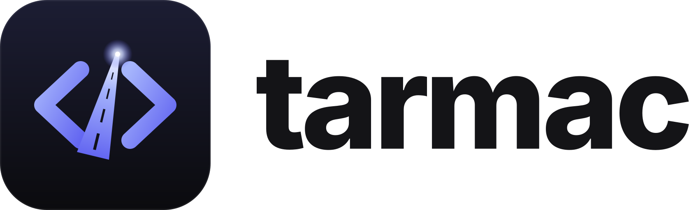
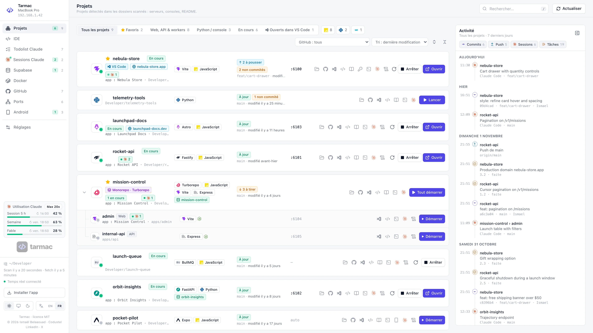
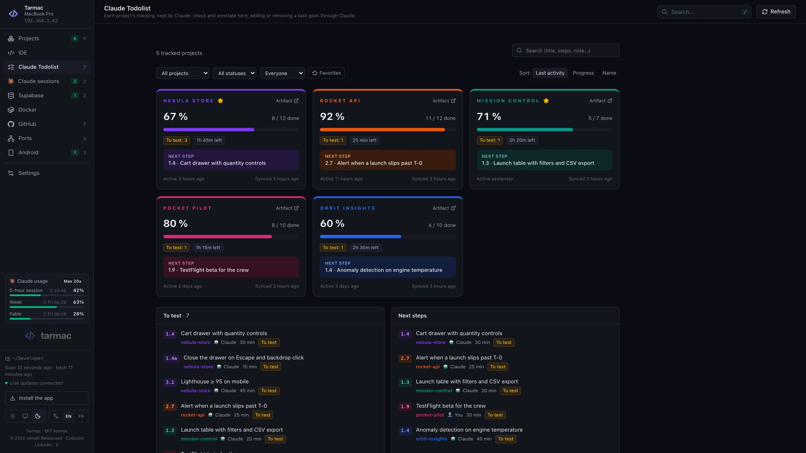
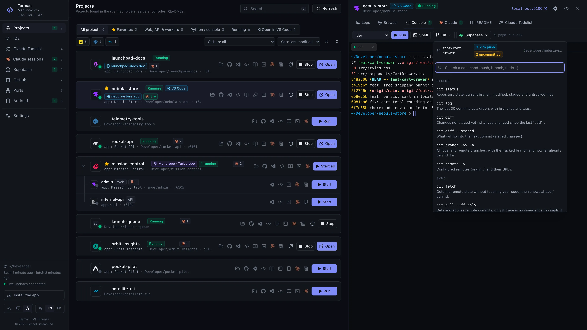
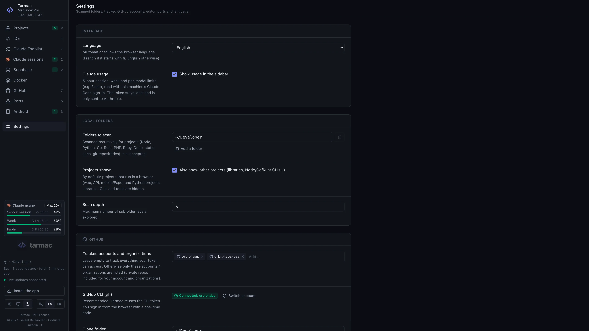

<p align="center">
  <picture>
    <source media="(prefers-color-scheme: dark)" srcset="brand/tarmac-logo-dark.svg">
    
  </picture>
</p>

<p align="center"><strong>Tarmac — tous vos projets et vos agents, une seule piste</strong></p>

<p align="center">Créé par <strong>Ismaël Belaaouad</strong> · Codustel — <a href="https://www.linkedin.com/in/codustel/">LinkedIn</a> · <a href="https://x.com/ismael_b_ai">X</a></p>

<p align="center"><a href="README.md">English version</a></p>

**Tarmac** est un tableau de bord local pour macOS. Il trouve tous les projets de vos dossiers de code, les démarre
et les arrête sur un port libre, affiche leurs logs en direct, offre une console et un menu Git dans le navigateur,
et y fait tourner les sessions de vos agents de code : Claude Code (suivi aussi depuis claude.ai ou votre téléphone)
et Codex, l'agent d'OpenAI inclus dans les abonnements ChatGPT. Il
tourne comme service de session sur `http://tarmac.localhost:7777` et s'installe comme une app (PWA).

L'interface est en anglais ou en français (réglage **Langue**, ou langue du navigateur). La documentation détaillée
de `docs/` est en anglais.

<picture>
  <source media="(prefers-color-scheme: dark)" srcset="docs/assets/home-fr-dark.webp">
  
</picture>

| Todolist Claude | Console et menu Git | Réglages |
|---|---|---|
|  |  |  |

## Pourquoi Tarmac

Une dizaine de projets, chacun avec son `pnpm dev`, son port, son `.env`, sa pile Supabase et ses sessions
d'agent. Tarmac les met sur une seule piste : une page pour voir ce qui existe, ce qui tourne, ce qui n'est pas à
jour avec GitHub et ce sur quoi vos agents travaillent, sans ouvrir dix terminaux ni se souvenir de quelle app a pris le
port 3000.

Tout reste sur votre Mac : Tarmac n'écoute que sur `127.0.0.1` et n'a aucune télémétrie. Ses seuls appels réseau
sont `git fetch` sur vos dépôts et l'API GitHub avec votre propre token, pour lister vos dépôts.

## Fonctionnalités

- **Projets** : apps web et API (Next, Vite, Nuxt, Astro, SvelteKit, Express, Fastify, NestJS, Django, FastAPI,
  Rails, Laravel, Go, Rust…), workers et projets Python, trouvés dans vos dossiers de code, monorepos compris. Un
  groupe par projet, nommé d'après son dépôt Git.
- **Lancement** : démarrer, arrêter, redémarrer, statut et logs en direct, port attribué sans conflit (fixe par
  app), apps lancées hors de Tarmac détectées et adoptées, « Libérer les ports » après un plantage.
- **Consoles** : un terminal interactif par projet dans le navigateur, commandes détectées (scripts
  `package.json`, `manage.py`, `cargo`, `go`…), virtualenv Python activé.
- **Git** : une trentaine de commandes expliquées dans un menu avec recherche (synchroniser, commiter, branches,
  mettre de côté, annuler), confirmation pour les commandes destructrices ; avance / retard et modifications non
  commitées d'un coup d'œil.
- **Claude Code** : toutes les sessions de chaque projet (actives ou terminées), sessions nouvelles ou reprises
  avec Remote Control dans une console intégrée, ouvertes aussi depuis claude.ai/code et l'app mobile.
- **Utilisation Claude** : votre plan et votre utilisation en direct dans la barre latérale (session de 5 h, semaine,
  limites par modèle comme Fable), lus avec la connexion de Claude Code ; le jeton reste sur votre Mac et n'est
  envoyé qu'à Anthropic.
- **Codex (ChatGPT)** : cochez Codex dans Réglages → Agents (Claude Code, Codex, ou les deux) pour avoir la même
  chose avec Codex : toutes les sessions de chaque projet, sessions nouvelles ou reprises dans une console intégrée,
  sessions lancées ailleurs avec la LED d'activité, la timeline, et l'utilisation de votre plan ChatGPT (fenêtres
  de 5 h et de la semaine) lue dans les fichiers de session locaux de Codex, sans jeton ni appel réseau.
- **Todolist** : un suivi des tâches par projet que votre agent tient à jour via le serveur MCP `tarmac` et le skill
  `suivi` (`/suivi` dans Claude Code, `$suivi` dans Codex), avec une copie `Todolist/` du dépôt et, pour Claude, un
  artefact claude.ai. Un bouton **▶** envoie une tâche en attente à une session Claude ou Codex au repos dans
  Tarmac, ou à une nouvelle session. Avec Claude Code seul, elle s'appelle la Todolist Claude.
- **GitHub** : vos dépôts et organisations, ceux qui sont clonés, « Cloner » en un clic (`gh` ou SSH).
- **Supabase local** : instances lancées, Studio, Mailpit, URL de l'API et de Postgres, projet rattaché.
- **Docker** : conteneurs groupés par projet compose avec état, santé, ports, CPU et mémoire, projet rattaché,
  démarrer / arrêter / redémarrer (Docker Desktop, OrbStack, Colima).
- **Et aussi** : README rendu, éditeur et vue de contrôle de source intégrés, ouverture dans VS Code / Cursor / Zed /
  WebStorm, projets ouverts dans VS Code signalés, URL de production par app, favoris, émulateurs Android, thème
  clair / sombre.

## Prérequis

- macOS (Apple silicon ou Intel).
- [Node.js](https://nodejs.org) **22.13 ou plus récent** (Tarmac utilise `node:sqlite`, intégré à Node).
- Facultatif : [GitHub CLI](https://cli.github.com) (`gh`), Docker Desktop / OrbStack / Colima (vue Docker, Supabase local),
  [Claude Code](https://claude.com/claude-code) et / ou [Codex](https://developers.openai.com/codex) (sessions
  d'agent et Todolist).

## Installation

```bash
npm install -g @codustel/tarmac
tarmac setup
```

`tarmac setup` crée `~/.tarmac/env`, installe un service de session (LaunchAgent), puis, avec votre accord et votre
mot de passe (`sudo`), ajoute `tarmac.localhost` à `/etc/hosts`.
Enfin, il propose l'intégration Claude Code, et celle de Codex quand `codex` est installé (ou avec
`--with-codex`). Lancez d'abord `tarmac setup --dry-run` pour voir chaque action sans rien modifier.

**L'adresse de Tarmac est `http://tarmac.localhost:7777`** : elle marche toujours, avec ou sans `sudo` (Chrome,
Firefox et Safari résolvent `*.localhost` d'eux-mêmes). `tarmac setup --no-sudo` saute l'étape `/etc/hosts`.
Une adresse sans port (`http://tarmac.localhost`) est facultative : `tarmac setup --port-80` redirige le port 80 vers
Tarmac avec `pf`. Elle est désactivée par défaut car, sur certains Mac, la règle coupe le port 7777 après un
redémarrage ; une redirection posée par une version précédente est retirée par `tarmac setup` (voir
[Dépannage](docs/troubleshooting.md#port-80)).

Pour installer Tarmac comme une app dans Chrome, laissez quelques secondes à la page : Chrome n'affiche son bouton
d'installation qu'après un court usage. En attendant, passez par le menu **⋮ → Caster, enregistrer et partager →
Installer la page en tant qu'application**.

Une installation **App Manager** (ancien nom de Tarmac) est migrée : son service est remplacé et ses données sont
copiées de `~/.app-manager` vers `~/.tarmac` (l'original est conservé). Si un `~/.tarmac` plus ancien existe déjà,
`tarmac setup` le signale et propose de le mettre de côté (`~/.tarmac.old-<date>`, rien n'est supprimé) avant la
copie.

## Premiers pas

1. Ouvrez `http://tarmac.localhost:7777` (`tarmac open`). Cliquez sur **Installer l'app** dans la barre latérale pour
   avoir une icône dans le Dock.
2. Dans **Réglages**, vérifiez les dossiers à scanner (par défaut les dossiers de code usuels qui existent :
   `~/Developer`, `~/Projects`, `~/dev`, `~/code`…), puis connectez la CLI GitHub en un clic.
3. Lancez une app avec **Démarrer**, ouvrez sa console, ou ouvrez une session d'agent depuis son onglet **Claude**
   ou **Codex** (cochez d'abord Codex dans **Réglages → Agents** ; Claude Code seul est le réglage par défaut).
4. Avec l'intégration, tapez `/suivi init` dans une session Claude Code, ou `$suivi init` dans une session Codex,
   pour créer la Todolist du projet. Codex demande une fois d'approuver le hook de début de session de Tarmac :
   tapez `/hooks` dans Codex.

`~/Documents` est protégé par macOS : acceptez la demande d'accès pour `node` au premier scan (voir
[Troubleshooting](docs/troubleshooting.md#access-to-documents)).

## Commandes

```text
tarmac status | start | stop | restart | logs | open
tarmac doctor          # vérifie Node, le service, le port, le domaine, gh, Docker et les agents cochés
tarmac update          # npm install -g @codustel/tarmac@latest, puis redémarrage
tarmac uninstall       # --purge supprime aussi ~/.tarmac
```

Les fenêtres ouvertes, app installée comprise, détectent une nouvelle version et se rechargent ; les apps et
consoles en cours ne sont pas touchées par une mise à jour.

### Commandes de la Todolist

À taper dans une session Claude Code, dans le dossier du projet (nécessite l'intégration proposée à
l'installation). Dans Codex, un skill s'appelle avec `$` : `$suivi init`, `$suivi sync`, `$suivi import` et
`$suivi theme` marchent de la même façon ; les commandes de l'artefact (`open`, `upgrade`) sont propres à Claude,
Codex passe par la vue Todolist de Tarmac et la copie `Todolist/` (voir [Codex](docs/codex.md)).

| Commande | Ce qu'elle fait |
|---|---|
| `/suivi init` | Crée la Todolist Claude du projet : enregistre le projet dans Tarmac, relève ses couleurs et polices, publie l'artefact claude.ai et ajoute la copie `Todolist/` au dépôt. Une fois par projet. |
| `/suivi open` | Affiche l'artefact du projet dans la session (Claude desktop), pour lire ou cocher les tâches sans quitter la conversation. |
| `/suivi import` | Remplit le suivi à partir des anciennes sessions Claude du projet : Claude liste les demandes trouvées, vous validez la liste, puis il écrit les tâches. |
| `/suivi sync [--all]` | Rattrape l'écart entre l'artefact et Tarmac quand l'un a changé sans l'autre (téléphone, autre ordinateur) ; la modification la plus récente l'emporte. `--all` traite tous les projets. |
| `/suivi upgrade [--all]` | Republie la page de l'artefact avec le dernier gabarit (nouveaux boutons comme **▶ Claude**, corrections), même URL, données conservées. À lancer après une mise à jour de Tarmac. `--all` traite tous les projets. |
| `/suivi theme` | Affiche les couleurs et polices de l'artefact et permet de les corriger si la détection s'est trompée. |
| `/suivi restructure` | Réorganise le suivi quand une phase devient trop grosse : la redécoupe en plusieurs phases, décale ou fusionne les suivantes (ex. phase 7 → 7 backend, 8 mobile, 9 frontend ; l'ancienne 8 devient 10). Claude montre d'abord un aperçu des nouveaux numéros ; identifiants des tâches et historique conservés. |
| `/suivi audit [--yes]` | Rattrape les statuts oubliés : Claude cherche les tâches déjà codées mais encore « à faire » (commits qui les citent, code présent), vous montre la liste, puis les passe « à tester » avec le commit en preuve. Un travail partiel reste à faire, avec ce qui manque dans la note. |

## Documentation (en anglais)

- [Configuration](docs/configuration.md) : dossiers, ports, domaine, variables d'environnement, réglages.
- [Claude Code](docs/claude-code.md) : sessions, Remote Control, serveur MCP, Todolist Claude et `/suivi`.
- [Codex](docs/codex.md) : sessions Codex, serveur MCP, règle `AGENTS.md`, skill `$suivi`, bouton ▶ et utilisation.
- [Security](docs/security.md) : où Tarmac écoute, ce qu'il peut lancer, ce qui demande `sudo` et pourquoi.
- [Troubleshooting](docs/troubleshooting.md) : accès à `~/Documents`, port 80, app installée, migration.
- [Windows (WSL 2)](docs/windows.md) : utiliser Tarmac sous Windows, et ce qui n'y marche pas.
- [Extensions](docs/extensions.md) (en anglais) : modules qui ajoutent des routes, une vue et des réglages sans modifier Tarmac.
- [Uninstall](docs/uninstall.md).

## FAQ

**Pourquoi `tarmac.localhost` ?** Les navigateurs considèrent `localhost` et `*.localhost` comme des contextes
sécurisés, nécessaires à l'app installée (PWA), au service worker et au presse-papiers. `http://tarmac.test`
fonctionne aussi et redirige vers cette adresse.

**Windows ou Linux ?** Tarmac est fait pour macOS et `tarmac setup` ne tourne que là. Sous Windows, il tourne dans
WSL 2, lancé à la main, avec quelques fonctions en moins : voir [Windows (WSL 2)](docs/windows.md).

**Faut-il le port 80 ?** Non. Tarmac utilise `http://tarmac.localhost:7777` ; `--port-80` sert seulement à avoir une adresse sans port.

**Un autre port ou domaine ?** Oui : `tarmac setup --domain mon.localhost`, et `TARMAC_PORT` dans `~/.tarmac/env`
(voir [Configuration](docs/configuration.md)).

**Faut-il un abonnement Claude ?** Seulement pour les fonctions Claude. Remote Control demande Claude Code connecté
à claude.ai (`/login`), pas une clé d'API.

**Ça marche avec ChatGPT ?** Oui, via Codex, l'agent de code d'OpenAI inclus dans les abonnements ChatGPT : cochez-le
dans Réglages → Agents et lancez `tarmac setup --with-codex`. Claude Code n'est alors pas nécessaire. Voir
[Codex](docs/codex.md).

## Contribuer

Issues et pull requests bienvenues, en français ou en anglais : voir [CONTRIBUTING.md](CONTRIBUTING.md). Les
failles de sécurité se signalent en privé ([SECURITY.md](SECURITY.md)).

## Licence

[MIT](LICENSE) — © 2026 Ismaël Belaaouad ([Codustel](https://www.linkedin.com/in/codustel/)). Suivez le projet sur [LinkedIn](https://www.linkedin.com/in/codustel/) et [X](https://x.com/ismael_b_ai).

Projet indépendant, non affilié à Anthropic ni à OpenAI. Claude et Claude Code sont des marques d'Anthropic ;
ChatGPT et Codex sont des marques d'OpenAI.
