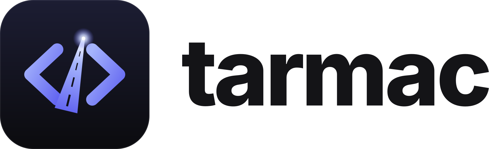
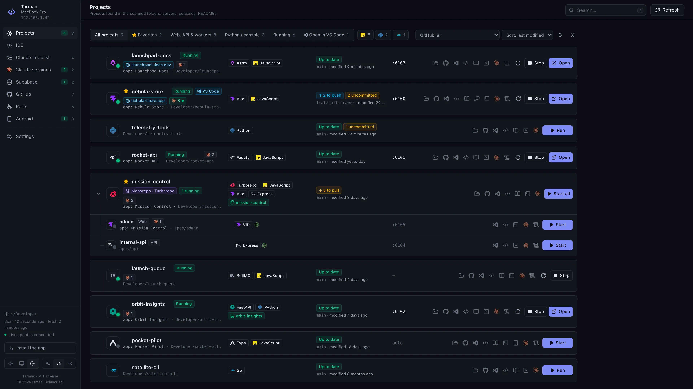
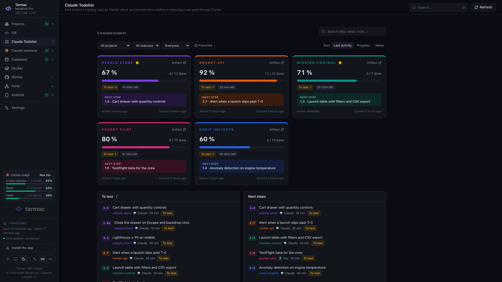
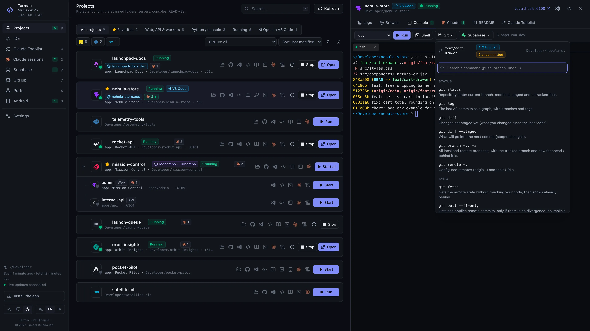
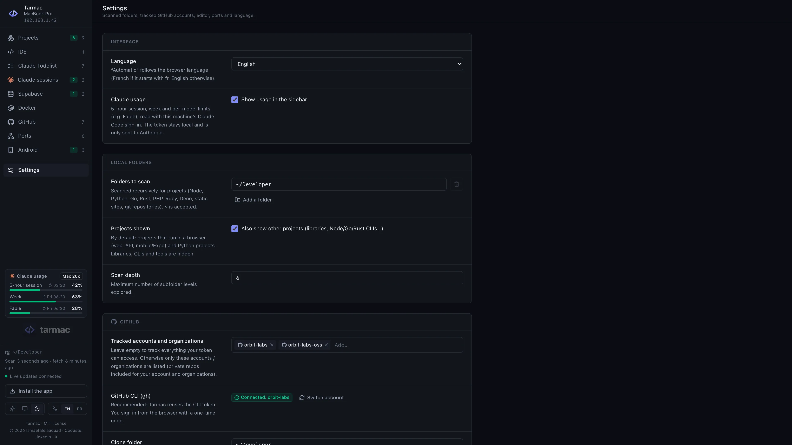

<p align="center">
  <picture>
    <source media="(prefers-color-scheme: dark)" srcset="brand/tarmac-logo-dark.svg">
    
  </picture>
</p>

<p align="center"><strong>Tarmac — the local runway for your projects and your Claude Code sessions</strong></p>

<p align="center">
  <a href="https://www.npmjs.com/package/@codustel/tarmac"></a>
  <a href="LICENSE"></a>
  
</p>

<p align="center">Created by <strong>Ismaël Belaaouad</strong> · Codustel — <a href="https://www.linkedin.com/in/codustel/">LinkedIn</a> · <a href="https://x.com/ismael_b_ai">X</a></p>

<p align="center"><a href="README.fr.md">Version française</a></p>

**Tarmac for Claude Code** is a local dashboard for macOS. It finds every project in your code folders, starts and
stops them with a free port, streams their logs, gives you a console and a Git menu in the browser, and opens
Claude Code sessions you can also follow from claude.ai or your phone. It runs as a login service on
`http://tarmac.localhost` and installs as an app (PWA).



| Claude Todolist | Console and Git menu | Settings |
|---|---|---|
|  |  |  |

## Why Tarmac

You have a dozen projects, each with its own `pnpm dev`, port, `.env`, Supabase stack and Claude Code sessions.
Tarmac puts them on one runway: one page to see what exists, what runs, what is out of sync with GitHub and what
Claude is working on, without opening ten terminals or remembering which app took port 3000.

Everything stays on your Mac: Tarmac listens on `127.0.0.1` only and has no telemetry. Its only network calls
are `git fetch` on your repositories and the GitHub API with your own token, to list your repositories.

## Features

- **Projects**: web apps and APIs (Next, Vite, Nuxt, Astro, SvelteKit, Express, Fastify, NestJS, Django, FastAPI,
  Rails, Laravel, Go, Rust…), workers and Python projects, found in your code folders, monorepos included. One
  group per project, named after its Git repository.
- **Run**: start, stop, restart, live status and logs, automatic port without conflicts (sticky per app), apps
  started outside Tarmac detected and adopted, "Free ports" after a crash.
- **Consoles**: an interactive terminal per project in the browser, detected commands (`package.json` scripts,
  `manage.py`, `cargo`, `go`…), Python virtualenv activated.
- **Git**: about 30 commands explained in a searchable menu (sync, commit, branches, stash, undo), with
  confirmation for destructive ones; ahead / behind and uncommitted changes at a glance.
- **Claude Code**: every session of each project (active or finished), new or resumed sessions with Remote
  Control in a built-in console, open from claude.ai/code and the mobile app too.
- **Claude usage**: your plan and live usage in the sidebar (5-hour session, week, per-model limits such as Fable),
  read with Claude Code's own sign-in; the token stays on your Mac and is only sent to Anthropic.
- **Claude Todolist**: a task tracker per project that Claude keeps up to date through the `tarmac` MCP server
  and the `/suivi` skill, mirrored in a claude.ai artifact and in a `Todolist/` copy in the repo. A **▶ Claude**
  button sends a pending task to an idle Claude session running in Tarmac, or to a new one.
- **GitHub**: your repositories and organizations, which ones are cloned, "Clone" in one click (`gh` or SSH).
- **Local Supabase**: running instances, Studio, Mailpit, API and Postgres URLs, linked project.
- **Docker**: containers grouped by compose project with state, health, ports, CPU and memory, linked project,
  start / stop / restart (Docker Desktop, OrbStack, Colima).
- **And**: README rendering, built-in editor and source control view, open in VS Code / Cursor / Zed / WebStorm,
  projects open in VS Code flagged, production URL per app, favorites, Android emulators, light / dark theme,
  English and French interface.

## Requirements

- macOS (Apple silicon or Intel).
- [Node.js](https://nodejs.org) **22.13 or later** (Tarmac uses the built-in `node:sqlite`).
- Optional: [GitHub CLI](https://cli.github.com) (`gh`), Docker Desktop / OrbStack / Colima (Docker view, local Supabase),
  [Claude Code](https://claude.com/claude-code) (sessions and Claude Todolist).

## Install

```bash
npm install -g @codustel/tarmac
tarmac setup
```

`tarmac setup` creates `~/.tarmac/env`, installs a login service (LaunchAgent), then, with your confirmation and
your password (`sudo`), adds `tarmac.localhost` to `/etc/hosts` and redirects port 80 to Tarmac's port 7777. Last,
it offers to set up the Claude Code integration. Run `tarmac setup --dry-run` first to see every action without
changing anything.

**The reference address is `http://tarmac.localhost:7777`**: it always works, with or without `sudo` (Chrome,
Firefox and Safari resolve `*.localhost` on their own). The address without port, `http://tarmac.localhost`, is a
bonus: `tarmac setup` checks that port 80 really reaches Tarmac and keeps the address with port otherwise (some
Macs load the redirect but do not apply it; see [Troubleshooting](docs/troubleshooting.md#port-80)).
`tarmac setup --no-sudo` skips those optional steps.

To install Tarmac as an app in Chrome, give the page a few seconds: Chrome shows its install button only after a
short use of the page. Meanwhile, use the menu **⋮ → Cast, save, and share → Install page as app**.

An existing **App Manager** install (Tarmac's former name) is migrated: its service is replaced and its data is
copied from `~/.app-manager` to `~/.tarmac` (the original is kept). If an older `~/.tarmac` is already there,
`tarmac setup` says so and offers to move it aside (`~/.tarmac.old-<date>`, nothing is deleted) before copying.

## First steps

1. Open `http://tarmac.localhost` (`tarmac open`). Click **Install the app** in the sidebar to get a Dock icon.
2. In **Settings**, check the folders to scan (by default the usual code folders that exist: `~/Developer`,
   `~/Projects`, `~/dev`, `~/code`…), then connect the GitHub CLI in one click.
3. Start an app with **Start**, open its console, or open a Claude session from its **Claude** tab.
4. With the Claude Code integration, type `/suivi init` in a session to create the project's Claude Todolist.

`~/Documents` is protected by macOS: accept the access request for `node` on the first scan (see
[Troubleshooting](docs/troubleshooting.md#access-to-documents)).

## Commands

```text
tarmac status | start | stop | restart | logs | open
tarmac doctor          # checks Node, the service, the port, the domain, gh, Docker and Claude Code
tarmac update          # npm install -g @codustel/tarmac@latest, then restart
tarmac uninstall       # --purge also deletes ~/.tarmac
```

Open windows, the installed app included, notice a new version and reload themselves; running apps and consoles
are not affected by an update.

### Claude Todolist commands

Typed in a Claude Code session, inside the project's folder (needs the Claude Code integration from the install).

| Command | What it does |
|---|---|
| `/suivi init` | Creates the project's Claude Todolist: registers the project in Tarmac, picks up its brand colors and fonts, publishes the claude.ai artifact and adds the `Todolist/` copy to the repo. Run it once per project. |
| `/suivi open` | Shows the project's artifact in the session (Claude desktop), to read or tick tasks without leaving the chat. |
| `/suivi import` | Fills the tracker from the project's past Claude sessions: Claude lists the requests it finds, you review the list, then it writes the tasks. |
| `/suivi sync [--all]` | Catches up between the artifact and Tarmac when one changed without the other (phone, another computer); the most recent change wins. `--all` does every project. |
| `/suivi upgrade [--all]` | Republishes the artifact page with the latest template (new buttons such as **▶ Claude**, fixes) at the same URL, data kept. Run it after updating Tarmac. `--all` does every project. |
| `/suivi theme` | Shows the artifact's colors and fonts and lets you fix them if the detection got them wrong. |

## Documentation

- [Configuration](docs/configuration.md): folders, ports, domain, environment variables, settings.
- [Claude Code](docs/claude-code.md): sessions, Remote Control, MCP server, Claude Todolist and `/suivi`.
- [Security](docs/security.md): what Tarmac listens on, what it can run, what needs `sudo` and why.
- [Troubleshooting](docs/troubleshooting.md): `~/Documents` access, port 80, installed app, migration.
- [Windows (WSL 2)](docs/windows.md): running Tarmac on Windows, and what does not work there.
- [Extensions](docs/extensions.md): modules that add routes, a view and settings without patching Tarmac.
- [Uninstall](docs/uninstall.md).

## FAQ

**Why `tarmac.localhost`?** Browsers treat `localhost` and `*.localhost` as secure contexts, which the installed app
(PWA), the service worker and the clipboard need. `http://tarmac.test` also works and redirects there.

**Does it work on Windows or Linux?** Tarmac is built for macOS and `tarmac setup` only runs there. On Windows it
runs inside WSL 2, started by hand, with a few features missing: see [Windows (WSL 2)](docs/windows.md).

**Port 80 is already used.** Tarmac then stays on `http://tarmac.localhost:7777`; nothing else changes.

**Can I use another port or domain?** Yes: `tarmac setup --domain my.localhost`, and `TARMAC_PORT` in
`~/.tarmac/env` (see [Configuration](docs/configuration.md)).

**Is a Claude subscription required?** Only for the Claude features. Remote Control needs Claude Code signed in to
claude.ai (`/login`), not an API key.

## Contributing

Issues and pull requests are welcome, in English or French: see [CONTRIBUTING.md](CONTRIBUTING.md). Please report
security issues privately ([SECURITY.md](SECURITY.md)).

## License

[MIT](LICENSE) — © 2026 Ismaël Belaaouad ([Codustel](https://www.linkedin.com/in/codustel/)). Follow the project on [LinkedIn](https://www.linkedin.com/in/codustel/) and [X](https://x.com/ismael_b_ai).

Not affiliated with Anthropic. Claude and Claude Code are trademarks of Anthropic.
